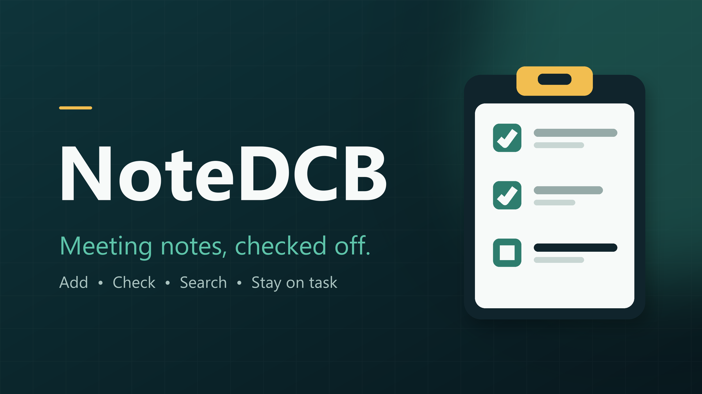

<p align="center"></p>

# NoteDCB

A Discord bot that keeps a shared meeting checklist. Add notes during a meeting, check them off as they get done, and search back through them later, so everyone stays on task.

Notes are stored per server in a local SQLite file. Each note gets a short ID (`#1`, `#2`, ...) and can optionally be tagged with a meeting name.

## How it works

Notes live in **folders** (for example one per meeting). A folder holds a list of **tasks**, and the whole folder is shown in one message.

Run **`/notes`** to open the menu. Everything is buttons, dropdowns and pop-up forms, so there's nothing to memorise:

- **New folder** opens a notepad. Type or paste a list and press Enter between items, and each line becomes its own task (leading `-`, `*` and `[ ]` are cleaned up).
- **Open a folder** from the dropdown to see all its tasks and a progress bar.
- **Tick tasks** in the dropdown to check them off. Untick to re-open.
- **Add tasks** opens the notepad again, **Remove** deletes tasks, **Search** looks across every folder, **Rename** renames the folder.
- **Clear done** and **Delete folder** need the *Manage Messages* permission (delete asks for confirmation).

Anyone in the channel can use the menu message at the same time. It stops responding after about 14 minutes, so just run `/notes` again.

### Typed shortcuts

| Command | What it does |
|---|---|
| `/task add text [folder]` | Add one task (folder is created if new, default `General`) |
| `/task check task` / `/task uncheck task` | Check off or re-open a task |
| `/task remove task` | Delete a task |
| `/task search query [status]` | Search tasks and folder names |

Task and folder fields autocomplete. Limits: 25 folders per server, 500 characters per task, 50 tasks per paste.

## Setup

1. Create an application at the [Discord Developer Portal](https://discord.com/developers/applications), add a Bot, and copy its token. Upload `assets/avatar.png` and `assets/banner.png` as the bot's icon and banner.
2. Invite it with the `bot` and `applications.commands` scopes (permissions: Send Messages, Embed Links).
3. Install and run (Python 3.10+):

```bash
pip install -r requirements.txt
cp .env.example .env     # then put your token in .env
python -m notebot
```

Set `DEV_GUILD_ID` in `.env` to have commands appear instantly in one test server; leave it blank for global commands (which can take a while to propagate the first time).

## Development

```bash
pip install -r requirements-dev.txt
pytest
python scripts/make_assets.py   # regenerate avatar and banner
```

## License

MIT
